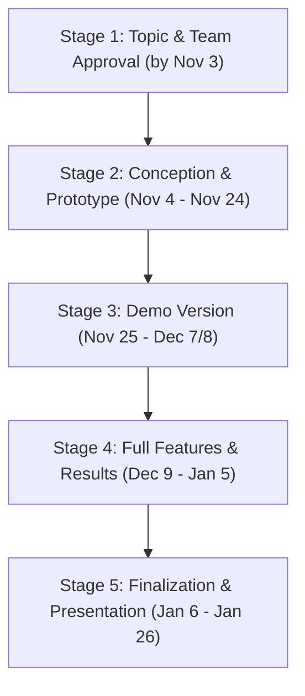

# LWE-QUBO Attack Lab

> **Implementation and Analysis of an Attack on a Simplified Post-Quantum Cryptographic System Using QUBO Optimization with a Web Interface**

A research and engineering lab project carried out by a four-person team. The goal is to study the effectiveness of solving a simplified **Learning With Errors (LWE)** cryptographic problem by reducing it to **Quadratic Unconstrained Binary Optimization (QUBO)** and running various classical, heuristic, and quantum-ready optimization algorithms to recover the secret key.

Repository: [https://github.com/kurs0n/lwe-qubo-attack-lab](https://github.com/kurs0n/lwe-qubo-attack-lab)

---

## Table of Contents

- [Overview & Objectives](#overview--objectives)
- [Mathematical Formulation of the Attack](#mathematical-formulation-of-the-attack)
  - [Learning With Errors (LWE) Formulation](#learning-with-errors-lwe-formulation)
  - [Reduction to QUBO](#reduction-to-qubo)
- [System Architecture & Tech Stack](#system-architecture--tech-stack)
- [Optimization Solvers](#optimization-solvers)
- [Analysis Scope & Evaluation Metrics](#analysis-scope--evaluation-metrics)
- [Project Directory Layout](#project-directory-layout)
- [Team Members & Roles](#team-members--roles)
- [Project Schedule & Milestones](#project-schedule--milestones)
- [Getting Started (Quickstart)](#getting-started-quickstart)

---

## Overview & Objectives

Lattice-based cryptography—and specifically the **Learning With Errors (LWE)** problem—is a core pillar of modern post-quantum cryptography (PQC) standards (such as NIST-standardized schemes like ML-KEM / CRYSTALS-Kyber).

In this project:
1. Small, controllable instances of the LWE problem are generated under configurable parameters (secret key length $n \approx 4-16$, number of observations $m$, noise level $e$, modulus $q$).
2. The problem of recovering the hidden binary secret $s \in \{0, 1\}^n$ is transformed into a **QUBO (Quadratic Unconstrained Binary Optimization)** matrix formulation.
3. The resulting QUBO problem is solved using multiple optimization algorithms:
   - Exhaustive Search (**Brute Force**) as the ground-truth baseline,
   - **Simulated Annealing** (metaheuristic),
   - **Tabu Search** (metaheuristic),
   - *(Optional)* **QAOA** (Quantum Approximate Optimization Algorithm) on a quantum simulator.
4. A full-featured **web application** provides interactive parameter controls, QUBO matrix heatmaps, solver execution, and statistical benchmark comparisons (success rate, execution time, noise tolerance).

---

## Mathematical Formulation of the Attack

### Learning With Errors (LWE) Formulation
In this simplified binary setting, the secret key is a binary vector:
$$s \in \{0, 1\}^n$$

The problem instance is generated according to the linear equation with noise:
$$b = As + e$$

Where:
- $A \in \mathbb{Z}^{m \times n}$ (or $\mathbb{Z}_q^{m \times n}$) is a known random public matrix,
- $s \in \{0, 1\}^n$ is the unknown secret key (binary vector),
- $e \in \mathbb{Z}^m$ is a small error/noise vector,
- $b \in \mathbb{Z}^m$ (or $\mathbb{Z}_q^m$) is the public observation vector.

The initial Python core implements the non-modular integer model $b = As + e$ used by the least-squares objective below. Modular observations over $\mathbb{Z}_q$ are not yet supported; converting them requires an objective that handles modular residuals rather than treating them as ordinary Euclidean differences.

### Reduction to QUBO
The objective of the attack is to recover the unknown secret $s$ given only public $(A, b)$. This is formulated as a binary least-squares optimization problem:
$$\min_{s \in \{0, 1\}^n} \|As - b\|^2$$

Expanding the Euclidean norm:
$$\|As - b\|^2 = (As - b)^T (As - b) = s^T (A^T A) s - 2 (A^T b)^T s + b^T b$$

Since $b^T b$ is an invariant constant offset with respect to $s$, and for binary variables $s_i \in \{0, 1\}$ we have the idempotent property $s_i^2 = s_i$, this quadratic form maps directly to the canonical **QUBO** objective:
$$\min_{s \in \{0, 1\}^n} \sum_{i \le j} Q_{ij} s_i s_j \quad \text{or} \quad \min_{s \in \{0, 1\}^n} s^T Q s$$

Where the upper-triangular or symmetric matrix $Q \in \mathbb{R}^{n \times n}$ encodes:
- **Linear terms (diagonal):** $Q_{ii} = (A^T A)_{ii} - 2(A^T b)_i$
- **Quadratic coupling terms ($i < j$):** $Q_{ij} = 2 (A^T A)_{ij}$ (for upper-triangular QUBO)

When the noise level $e$ is sufficiently bounded, the global minimum of this energy landscape corresponds exactly to the secret key $s$.

---

## System Architecture & Tech Stack

```
┌───────────────────────────────────────────────────────────┐
│                Static Web App (React/TypeScript)           │
│ Interactive article, playground, and visualizations       │
│ Browser solvers run in Web Workers; no runtime API needed │
└──────────────────────────────┬────────────────────────────┘
                               │ imports core + optional JSON
┌──────────────────────────────▼────────────────────────────┐
│          TypeScript Core + Optional Static Data            │
│ LWE → QUBO, solvers, seeded traces                         │
└───────────────────────────────────────────────────────────┘

Python library: manual experiments and optional reference solvers/QAOA
```

### Technology Stack
- **Python library**: Python 3.10+, NumPy, [dwave-samplers](https://github.com/dwavesystems/dwave-samplers); used locally, not as a web server
- **Interactive core**: TypeScript, used by the browser
- **Frontend**: Vite + React/TypeScript, Web Workers, SVG visualizations
- **Deployment**: Static hosting (for example, GitHub Pages); no runtime backend or Docker required

---

## Optimization Solvers

1. **Brute Force (Exhaustive Search)**:
   - Self-contained, vectorized solver evaluating all $2^n$ combinations.
   - Serves as the authoritative ground truth for small instances ($n \le 16$) to verify global optimality.
2. **Simulated Annealing (SA)**:
   - Probabilistic heuristic based on simulated cooling of a physical system.
   - The Python package provides a `dwave-samplers` reference wrapper; the TypeScript core has a deterministic implementation for the browser and benchmarks.
3. **Tabu Search**:
   - Metaheuristic leveraging a short-term tabu list to prevent cycling and escape local energy minima.
   - The Python package provides a `dwave-samplers` reference wrapper; the TypeScript core implements tabu search locally.
4. **QAOA (Quantum Approximate Optimization Algorithm - Optional)**:
   - Hybrid quantum-classical variational algorithm run on a quantum state simulator for small problem dimensions.

---

## Analysis Scope & Evaluation Metrics

The experimental study and interactive UI focus on the following key metrics:
- **Success Rate**: The ratio of correctly recovered secrets $\hat{s} == s$ over total experimental trials.
- **Execution Time**: Wall-clock and CPU time across solver types as a function of key length $n$.
- **Impact of Key Length ($n$)**: Scaling behavior and transition thresholds across $n \in [4, 16]$.
- **Impact of Noise ($e$)**: Degradation of recovery accuracy and energy gap as the noise magnitude grows.
- **Energy Gap & Hamming Distance**: Deviation of heuristic solution energies from ground-truth minimum energy, plus Hamming distance $d_H(s, \hat{s})$.

---

## Project Directory Layout

```plaintext
lwe-qubo-attack-lab/
├── lwe_qubo/                 # Installable Python library
│   ├── crypto/               # LWE instance model and generation
│   ├── qubo/                 # LWE-to-QUBO conversion and export
│   └── solvers/              # Simulated annealing and tabu search
├── examples/
│   └── visualize_lwe_qubo.py # End-to-end visualization example
├── tests/                    # Library tests
├── pyproject.toml            # Package metadata and dependencies
├── requirements.txt          # Runtime dependencies
├── packages/
│   └── core/                 # LWE, QUBO, solvers, seeded RNG, trace types
├── apps/web/                 # Static React article and solver playground
└── docs/                     # Design documentation, reports, and presentation slides
```

There is no backend or benchmark CLI in the repository. The Python package remains a local library for manual experiments and reference runs; it does not serve requests. The web application is static and uses the TypeScript core directly. Optional precomputed research charts can be supplied as static JSON.

---

## Team Members & Roles

| Member | Role | Primary Responsibilities |
| :--- | :--- | :--- |
| **Patryk Kurek** | Team Lead, Cryptography & QUBO Model | Contact with instructor, LWE instance generator, QUBO formulation and mathematical validation |
| **Piotr Ziobrowski** | Optimization Algorithms | Solver implementation & integration (`dwave-samplers`, Brute Force, QAOA), benchmark scripts |
| **Kacper Sikora** | Web Application | React/TypeScript interactive article, visualizations, Web Worker integration, static deployment |
| **Wojciech Marcela** | Testing, Analytics & Documentation | Unit & integration tests, experimental data analysis, final report, presentation coordination |

---

## Project Schedule & Milestones

The project is structured into 5 iterative stages:



- **Stage 1 (until Nov 3)**: Team constitution, role division, GitHub repo setup, preliminary literature survey on lattice-to-QUBO methods.
- **Stage 2 (Nov 4 – Nov 24)**: Conception and prototype: derivation of QUBO formulation, LWE generator prototype, initial Brute Force and Simulated Annealing prototypes, and frontend scaffold.
- **Stage 3 (Nov 25 – Dec 7/8)**: Demonstrator version (in-person check-in): parameterized generator $(n, m, q, e)$, QUBO matrix export, Tabu Search integration, unified solver interface, basic UI, and unit tests.
- **Stage 4 (Dec 9 – Jan 5)**: Full functionality & results: QUBO size analysis, comprehensive experiments (accuracy and timing vs $n$ and noise), interactive article, and static visual analytics. *(Dec 22 – Jan 1: holiday buffer)*.
- **Stage 5 (Jan 6 – Jan 26)**: Final delivery: consultation adjustments, final report, backup demo recording, online dry run (Jan 22–23), final presentation (Jan 26).

---

## Getting Started (Quickstart)

### Local Development Setup

#### Python library:
```bash
python -m venv .venv
source .venv/bin/activate  # On Windows: .venv\Scripts\activate
pip install -e ".[dev]"
python -m pytest
```

The `lwe_qubo` package provides validated LWE instance generation, least-squares-to-QUBO conversion, JSON/CSV/Matrix Market export, and local simulated-annealing and tabu-search solvers via `dwave-samplers`.

To visualize a noisy 8-bit example, run this script from the repository root:

```bash
python examples/visualize_lwe_qubo.py
```

It opens and saves `lwe_qubo_visualization.png`, showing the QUBO matrix, energies for all $2^n$ candidates, and the true secret alongside both sampler results. The default instance has 8 secret bits, 16 observations, and nonzero bounded noise. Use `--n`, `--m`, `--noise-bound`, or `--seed` to change it, and `--output path/to/plot.png` to choose another output path.

The solver classes accept a `QUBO` returned by `lwe_to_qubo`; supply `seed` for reproducible sampler runs. For example:

```python
from lwe_qubo.crypto.generator import generate_lwe_instance
from lwe_qubo.qubo.converter import lwe_to_qubo
from lwe_qubo.solvers import SimulatedAnnealingSolver

instance = generate_lwe_instance(n=4, m=8, seed=7)
qubo = lwe_to_qubo(instance.A, instance.b)
result = SimulatedAnnealingSolver(num_sweeps=1000).solve(
    qubo, num_reads=100, seed=7, true_secret=instance.secret
)
```

#### TypeScript workspaces:

Install dependencies and run the core tests, type checks, and production build:

```bash
npm install
npm test
npm run check
npm run build
```

Start the static React application with:

```bash
npm run dev --workspace @lwe-qubo/web
```

For manual experiments and Python reference solvers, use the Python library instructions above. The TypeScript generator uses its own deterministic seeded PRNG; a given seed is repeatable within TypeScript, but does not reproduce NumPy's random sequence.
